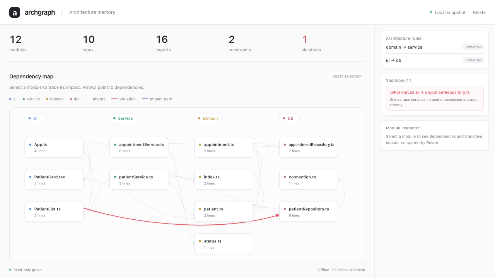
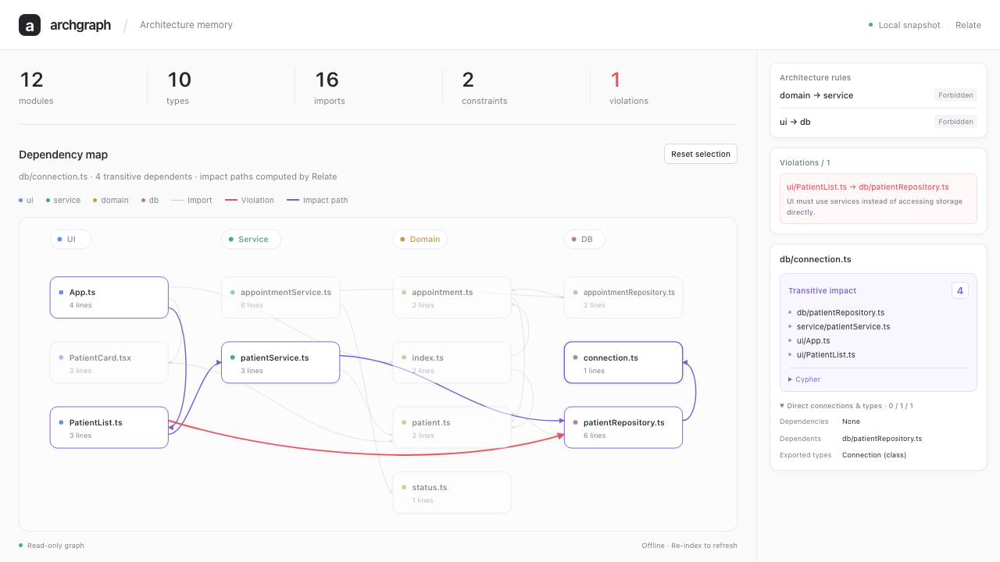
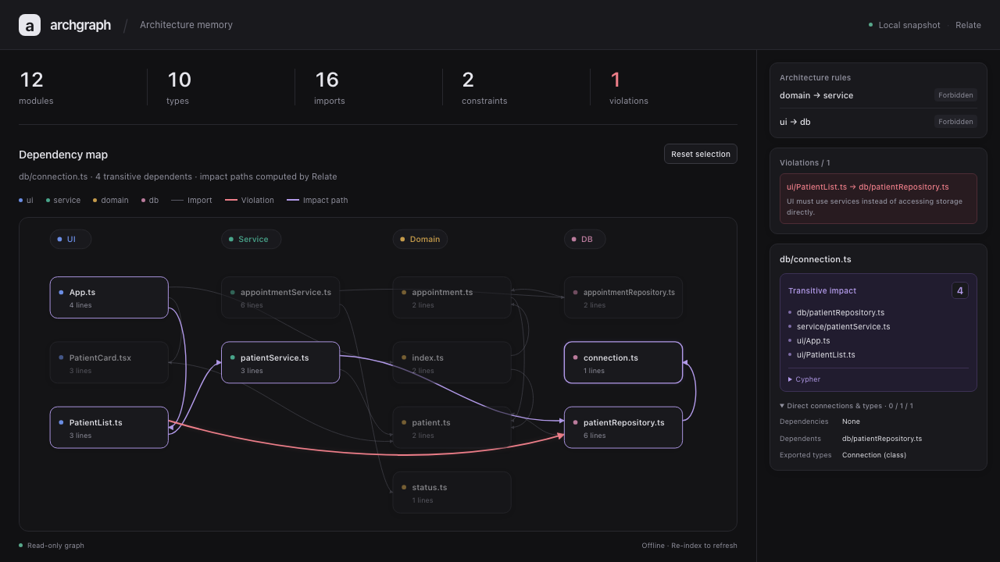

# archgraph

Local architecture memory for coding agents, powered by Relate.

## Use case

Before changing a TypeScript repository, an agent needs to know which modules depend on a file, which types it exports, and which layer boundaries must hold. archgraph turns those facts into a local, queryable graph. No LLM, cloud service, IDE integration, or general code-search index is involved.

The included clinic app deliberately breaks one rule: `ui/PatientList.ts` imports `db/patientRepository.ts` directly. A graph query discovers this violation; it is not hard-coded in JavaScript.

## How it uses Relate

**Mode:** embedded Node.js client (`@relate/relate` 1.2.0), with a committed single-file `.rl` store. The optional Relate CLI and MCP provide read-only inspection.

**Why this mode:** no database server or credentials to configure; the engine runs in the CLI process, and judges can open the exact demo graph directly. Relate executes the joins for constraint checks and variable-length dependency traversal. A JSON cache would require reimplementing those graph operations.

### Graph model

| Node | Properties | Relationships |
| --- | --- | --- |
| `Layer` | `name`, `pattern` | Receives `IN_LAYER` |
| `Module` | `path`, `layer`, `loc` | `IN_LAYER` → Layer; `IMPORTS {specifiers}` → Module; `DECLARES`, `USES_TYPE` → Type |
| `Type` | `name`, `kind`, `module` | Exported interface, type alias, class or enum |
| `Constraint` | `id`, `from`, `to`, `rule`, `reason` | `FORBIDS_FROM`, `FORBIDS_TO` → Layer |

`IMPORTS` points from importer to dependency. Repeated imports between the same module pair merge into one edge. Static re-exports and import-equals declarations also form dependency edges. `USES_TYPE` is a cheap import-name match to a type exported by the direct target module, not proof of semantic usage.

The violation query, verbatim from the repository:

```cypher
MATCH (c:Constraint)-[:FORBIDS_FROM]->(lf:Layer)<-[:IN_LAYER]-(m:Module)-[:IMPORTS]->(n:Module)-[:IN_LAYER]->(lt:Layer)<-[:FORBIDS_TO]-(c)
RETURN c.id AS id, m.path AS from, n.path AS to, c.reason AS reason
ORDER BY id, from, to
```

For transitive impact, Relate evaluates `IMPORTS*`, deduplicates results, and excludes the starting module even when a cycle exists.

## Setup and run

Prerequisites: Node.js **18 or newer**, npm, and a platform supported by the Relate native npm package. Verified here on macOS arm64 with Node.js 25.2.1 and Relate 1.2.0; other OS/Node combinations were not exercised.

Optional Relate CLI (official installer):

```sh
curl -sSfL https://relatedb.ai/install.sh | bash
```

From a fresh clone, first result:

```sh
npm install && npm run build && npm run demo
npm run serve
# Open http://localhost:4317
```

`demo` prints the summary and the intentionally planted violation, and exits successfully. Example summary:

```json
{"modules":12,"types":10,"imports":16,"constraints":2,"violations":1}
```

Example violation:

```text
ui-no-db: ui/PatientList.ts → db/patientRepository.ts
UI must use services instead of accessing storage directly.
```

Actual CLI output is formatted JSON, suitable for agents. Use the `violations` command as a CI gate: it exits **1** when violations exist, **0** otherwise; usage/query errors exit **2**.

```sh
node dist/cli/main.js index examples/clinic-app
node dist/cli/main.js deps ui/PatientList.ts
node dist/cli/main.js dependents db/connection.ts --transitive
node dist/cli/main.js types domain/patient.ts
node dist/cli/main.js summary
node dist/cli/main.js violations
node dist/cli/main.js cypher 'MATCH (m:Module) RETURN m.path AS path'
node dist/cli/main.js serve --port 4317
```

All commands accept `--store path` (default: `store/archgraph.rl`, relative to the current working directory). Run the npm scripts from the repository root. Module paths are relative to the indexed project, use `/`, and include extensions. `--allow-violations` makes a reporting-only invocation exit successfully.

The web view works offline: SVG and JavaScript are committed; no CDN, fonts or runtime network dependency. The demo layout fits **1280×720** with no scrolling in the home view or any sample module selection (with Cypher collapsed). Narrow screens keep the graph horizontally scrollable inside its own panel and stack the sidebar below it. The theme automatically follows `prefers-color-scheme`; system fonts and all assets remain offline, with 150ms selection/highlight transitions and a reduced-motion override.

Nothing is selected on load: all nodes appear at full opacity. Click a module or focus it and press Enter to inspect dependencies, dependents, transitive impact, and exported types. Unrelated nodes dim slightly to 0.55 opacity. Purple outlines and paths show the transitive dependents of the selected module; a stronger purple outline identifies the selection. Nodes are white cards with subtle shadows and layer-color dots in light mode, with neutral dark cards in dark mode. The one-line legend distinguishes layer colors, import edges, violations, and impact paths. Columns follow `archgraph.config.json` layer order at indexing time: **UI → Service → Domain → DB** in the sample. The read-only graph endpoint returns layers in snapshot insertion order, without changing the graph model or stored file. Side ports and smooth Bézier curves replace orthogonal routing; normal edges are 1px at 25% opacity, becoming fully visible on hover or selection. The violation takes a short, direct 2px red curve with a soft glow and stays above other edges, including when it is also on an impact path.

For a short demo: start at the overview, click the violation card to focus the forbidden import, then select `db/connection.ts` to show **4 transitive dependents and 5 path edges**. Expand the sidebar’s **Cypher** box to inspect the exact variable-length query and bound module parameter. “Direct connections & types” expands by default for every module, including large impact results. Larger results use compact spacing while retaining all module names. Architecture rules expand individually to show their reasons. Reset selection or press Escape to return to the overview.

The purple path edges are returned by Relate, not found by JavaScript traversal:

```cypher
MATCH p = (m:Module)-[:IMPORTS*]->(target:Module {path:$module})
WHERE m.path <> target.path
UNWIND relationships(p) AS edge
RETURN DISTINCT startNode(edge).path AS from, endNode(edge).path AS to
ORDER BY from, to
```

JSON endpoints: `/api/graph`, `/api/violations`, `/api/summary`, and `/api/module?path=domain%2Fpatient.ts`. The module endpoint includes `impact` (transitive modules) and `impactPaths: {edges, query}` from the read-only store. The HTTP server binds only to `127.0.0.1`; Ctrl-C stops it.

Demo screenshots, captured with Playwright at 1280×720: [Overview](docs/screenshots/home.png), [Violation](docs/screenshots/violation.png), [Transitive impact](docs/screenshots/impact.png), [Dark impact](docs/screenshots/impact-dark.png).







## Where the data lives

`store/archgraph.rl` is a real Relate single-file store, committed with the sample architecture: 4 layers, 12 modules, 10 types, 2 constraints. No auxiliary JSON graph is used as the database.

Rebuild it from the sample source:

```sh
npm run index:sample
```

Inspect it directly:

```sh
relate --database store/archgraph.rl --read-only --mode envelope 'MATCH (n) RETURN labels(n) AS l, count(*) AS c'
```

Stop the web server before rebuilding the store, then restart it. Read-only opens are frozen snapshots; `.rl` stores cannot be read beside an active writer. Relate 1.2 has no Node close API: our repository `close()` checkpoints writers and prevents further wrapper calls, but the native handle/lease lasts until the process exits. CLI writes and web reads therefore run in separate processes.

### Code architecture

- `src/domain/`: graph contracts and runtime config validation.
- `src/indexer/`: compiler API parsing, local module resolution, and snapshots.
- `src/graph/`: the only Relate client integration; parameterized `UNWIND` batches replace the graph atomically in one transaction, with rollback on errors.
- `src/query/`: architecture read queries.
- `src/cli/`: argument handling and command dispatch.
- `src/web/` + `web/`: read-only HTTP adapter and offline SVG UI.
- `tests/`: Node's built-in test runner, including native database and HTTP integration.

### Configuration and limits

Each indexed project needs `archgraph.config.json`; see [the sample](examples/clinic-app/archgraph.config.json). `layers` contains `{name, pattern}` entries; patterns support exact paths, directory prefixes (`ui/`), `*` within one path segment, and `**` across segments (`ui/**`). Overlapping layer rules are rejected; unmatched modules enter `unassigned`. Constraint IDs and layer names must be unique, references must exist, and the only v1 rule is `must_not_import` for direct imports. The whole store belongs to one indexed project and is replaced on each successful index.

The indexer recursively reads `.ts`, `.tsx`, and `.d.ts` files, excluding symlinks, `node_modules`, `dist`, `.git`, and `store`. Compiler options come from the project's optional `tsconfig.json`; its include/exclude lists do not filter the traversal. Relative imports resolve through the TypeScript compiler API, including index modules and explicit `.ts`/`.tsx`/`.js` specifiers. Unresolved relative imports fail before the store is changed. External package imports and non-relative aliases are ignored. Dynamic `import()`, CommonJS `require()` calls, namespace-member type uses, semantic type usage and barrel-following `USES_TYPE` are outside v1. Re-export dependencies are captured, but `Type` nodes describe declarations owned by each file and exposed through its exports, including local export lists and default declarations.

This is architecture **memory**, not a continuously updated compiler truth: rerun indexing after code/config changes. It does not type-check the project or model runtime dependency injection. Transitive queries may be expensive on large, densely connected repositories; the shipped example is deliberately small. Binary stores are easy to inspect and share, but not useful for line-by-line Git diffs; source and config remain the reproducible inputs.

### Tests

```sh
npm test
npx tsc --project examples/clinic-app/tsconfig.json
```

Tests cover sample counts, layers, import resolution, aliases/types, invalid config, unresolved imports, exact violation detection through Relate, dependency traversal including cycles, transactional rollback, repeated replacement, cross-process `.rl` reopening, read-only rejection, CLI exit codes and offline HTTP endpoints. HTTP tests require permission to bind a temporary loopback port.

### MCP inspection (optional)

Use the official Relate MCP server; archgraph does not implement another one. Replace the database argument with an absolute path for your clone:

```json
{
  "mcpServers": {
    "archgraph": {
      "command": "relate",
      "args": ["serve", "--mcp", "stdio", "--database", "/absolute/path/to/archgraph/store/archgraph.rl", "--read-only"]
    }
  }
}
```

Example agent queries:

```cypher
MATCH (m:Module)-[:IMPORTS*]->(:Module {path:'db/connection.ts'})
RETURN DISTINCT m.path AS dependent ORDER BY dependent
```

```cypher
MATCH (:Module {path:'domain/patient.ts'})-[:DECLARES]->(t:Type)
RETURN t.name AS name, t.kind AS kind
```

```cypher
MATCH (l:Layer)<-[:IN_LAYER]-(m:Module)
RETURN l.name AS layer, count(m) AS modules ORDER BY layer
```

Documentation consulted: [Node API](https://relatedb.ai/docs/reference/api/javascript/), [Node embedding](https://relatedb.ai/docs/guides/embed/node/), [store layouts](https://relatedb.ai/docs/guides/storage/choose-a-store-layout/), [Cypher paths](https://relatedb.ai/docs/reference/cypher/patterns/), [MCP](https://relatedb.ai/docs/guides/serve/mcp/).

### Publishing note

When publishing the public GitHub repository, add topics `relate` and `relate-neo4j-hackathon`. This task only prepares a local Git repository; it does not add a remote, push, or publish.

Licensed under Apache-2.0. Copyright 2026 Ethan Luo.
